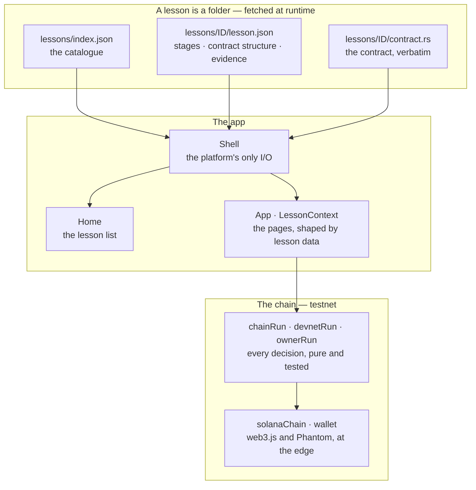

<h1 align="center">Solana Prism</h1>

<p align="center"><strong>One Solana vulnerability per lesson — taken apart along the execution path the bug travels, then run for real on testnet.</strong></p>

<p align="center">


=20.10" src="https://img.shields.io/badge/node-%3E%3D20.10-24292F?style=flat-square&logo=nodedotjs&logoColor=white">
</p>

<p align="center"><strong>English</strong> · <a href="README.zh-CN.md">中文</a></p>


*The first lesson, page by page. This contact sheet and the recorded walkthrough
(`docs/screenshots/walkthrough.mp4`) were captured before the second lesson
shipped, so both show lesson one only.*

## What it is

Solana Prism is a platform for Solana smart-contract security lessons. Each
lesson picks one vulnerability and takes the contract apart along the execution
path the bug actually travels — every stage the call passes through, and the one
line where the mistake lives. Then it runs the attack for real: the attack a
reader watches is a transaction on testnet, and every claim the lesson makes has
a signature behind it that an explorer can confirm. Nothing is asserted that the
chain has not confirmed, so the verdict under an attack is the cluster's answer
rather than a local rule, and the verify panel speaks from the lesson's evidence
rather than from a deployment flag.

The platform ships two lessons.

## The two lessons

| Lesson | The vulnerability | Why it is subtle |
|---|---|---|
| **The signature nobody asked for** | `authority: AccountInfo<'info>` where `Signer<'info>` was needed. | The `withdraw` handler compares the caller against the stored admin, but the runtime is never asked to check a signature — declaring `AccountInfo` asks for nothing, so the attacker hands over the admin's public address and it is accepted. |
| **The account that was not ours** — the owner nobody checked | `credit: UncheckedAccount<'info>` where `Account<'info, Credit>` was needed. | The handler trusts a credit because its bytes deserialise correctly, without ever asking who owns the account those bytes came from. An account's data is not its identity — its owner is. |

On Solana you *declare* what an account must be and the runtime enforces it
before your handler runs. Declared constraints are enforced for free;
hand-written checks only if you remember to write them.

## On-chain evidence

Both lessons are deployed to **testnet**, and both attacks have been run against
the deployed programs. Every address and signature below is read from
`frontend/public/lessons/<id>/lesson.json`; both lessons share one admin address,
`DMkwnXZ6Gy7X8fkzSyBCdCuk3E2CFrwCmhV9A44qGU7T`, the public half of the keypair
that `initialize` records as the vaults' authority.

**Lesson one — the signature nobody asked for** (`missing-signer`)

| | |
|---|---|
| Vulnerable program | [`7SdcJctnNWx1CPrfJr5MR8jWgDLtW173FoYyCm8rP8U2`](https://solscan.io/account/7SdcJctnNWx1CPrfJr5MR8jWgDLtW173FoYyCm8rP8U2?cluster=testnet) |
| Repaired program | [`9CFbfwYirp1ZFfwA2fYKKaeVoYU9R3cKNBukvn8EayPq`](https://solscan.io/account/9CFbfwYirp1ZFfwA2fYKKaeVoYU9R3cKNBukvn8EayPq?cluster=testnet) |
| Attack transaction (run for real) | [`2d4hd6SnxtriuegGRGRgM542Cr4qsGbkYQUgx3shR3fxdFSmUFRrGvM7L9zwK2CFBe1KTRafeyqD66nj2Mm4tEEW`](https://solscan.io/tx/2d4hd6SnxtriuegGRGRgM542Cr4qsGbkYQUgx3shR3fxdFSmUFRrGvM7L9zwK2CFBe1KTRafeyqD66nj2Mm4tEEW?cluster=testnet) |
| The same call on the repaired build | `InstructionError: [0, Custom(3010)]` |
| Vault the attack moved | a counter, `1000 → 500` |

**Lesson two — the account that was not ours** (`missing-owner`)

| | |
|---|---|
| Vulnerable program | [`38hLgAJyNUnRiZvWVWAwTwt9cZMA6wzyPQm3QQDAdWJL`](https://solscan.io/account/38hLgAJyNUnRiZvWVWAwTwt9cZMA6wzyPQm3QQDAdWJL?cluster=testnet) |
| Repaired program | [`BC5AtnTTYDfhrhxfng7JPUfoVwvcnvPrzuQsE7HpQW93`](https://solscan.io/account/BC5AtnTTYDfhrhxfng7JPUfoVwvcnvPrzuQsE7HpQW93?cluster=testnet) |
| Attacker's counterfeit program | [`AKW7vUPNvueeG31GV7gRCRtPQyvsmvat4RnzjPXjxiHR`](https://solscan.io/account/AKW7vUPNvueeG31GV7gRCRtPQyvsmvat4RnzjPXjxiHR?cluster=testnet) |
| Attack transaction (run for real) | [`5odwAQjoHW5P3AZCtCByTnqZdJB7ZavvbSiTuegcGGJowuwbHhzbBFbcQJtEvPWsRxvaBRWXfhdmdVcm1mt48BRG`](https://solscan.io/tx/5odwAQjoHW5P3AZCtCByTnqZdJB7ZavvbSiTuegcGGJowuwbHhzbBFbcQJtEvPWsRxvaBRWXfhdmdVcm1mt48BRG?cluster=testnet) |
| The same call on the repaired build | `InstructionError: [1, Custom(3007)]` |
| Vault the attack moved | lamports, `50,000,000 → 0` |

The two vaults are not the same kind of thing, and the README will not blur it:
lesson one's vault holds a counter, and the attack moves it from 1000 to 500.
Lesson two's vault holds lamports, and the attack moved all 0.05 SOL of them out
— real value, on testnet.

## Quick start

```bash
cd frontend
npm install
npm run dev      # http://localhost:5173 — opens on the lesson list
npm test         # the unit suite (33 files, 359 tests)
npm run build    # tsc -b && vite build
```

Node **20.10.0 or newer** runs the app. Vite is pinned to 6.x (Vite 7 needs
`^20.19.0 || >=22.12.0`). The scripts under `tools/` additionally need
**Node >= 22**.

Lesson folders are fetched over HTTP, so the app needs the dev server (or the
built `dist/`) — opening it from a `file://` URL does not work.

## How it works



The split is by **what can be tested without a browser**, and it runs top to
bottom:

| Layer | Responsibility | Where |
|---|---|---|
| Shell | the platform's only I/O — fetch the catalogue, fetch the chosen lesson, decide list-or-lesson | `components/Shell.tsx` |
| Lesson format | the folder the app renders, and the JSON boundary: the guarantees TypeScript gives over an import are re-established at runtime | `public/lessons/`, `lib/lesson.ts` |
| Render pipeline | page count and stage count come from the lesson's own arrays; the lesson reaches the tree as a prop and a context, never as an import | `App.tsx`, `lib/lessonContext.ts` |
| Decision layer | the pool scan, a transaction's construction, what an outcome means — pure functions over injected I/O, so every branch is a unit test | `lib/chainRun.ts`, `lib/devnetRun.ts`, `lib/ownerRun.ts` |
| Edge adapters | the only files that know about web3.js, or about Phantom | `lib/solanaChain.ts`, `lib/wallet.ts` |
| Presentation | the components, and every user-visible string in two languages behind one typed catalogue | `components/`, `i18n/` |

### The lesson folder

**A lesson is data.** A lesson is a folder of static files that the app fetches
at runtime and renders; nothing below the shell imports lesson content, so the
pages, the flow and the verify panel are driven entirely by what the folder says.

```
public/lessons/
  index.json              the catalogue the home page reads
  <id>/lesson.json        stages, the contract's structure, the on-chain evidence
  <id>/contract.rs        the contract, verbatim
```

`lesson.json` carries the stage list, which lines of the contract become which
stage, the margin notes keyed to those lines, and the evidence the verify panel
speaks from. The renderer takes the number of stages from that array rather than
assuming six, and takes each stage's scatter offsets and code lines from the
data — which is what makes the format general rather than a shape one lesson
happens to fit.

JSON erases one guarantee TypeScript gave for free: that every `sayKey`,
`nameKey` and note key names a real catalogue entry. `lib/lesson.ts` re-establishes
it at runtime, so a key that is not in the message catalogue, or a contract
region that runs off the end of `contract.rs`, is a `LessonError` the shell
reports plainly — never a blank sentence on screen, and never a white page.

## Executing for real

*Execute* is signed by a dedicated demo keypair that ships in the frontend
(`config/demoSigner.ts`). That is a deliberate, accepted trade-off: without it,
a visitor with no wallet — almost everyone — could only watch an animation,
which is exactly the thing this demo exists to argue against. The key is
testnet-only, funded with a little testnet SOL for fees, and is never the pool's
authority — the `authority` account passed to `withdraw` is the admin's public
key, and nobody signs as the admin. Anyone who reads the bundle can spend its
fee balance; that is the whole of the exposure, and the pool is refillable. **It
must never be pointed at mainnet.**

The verdict is the chain's (`lib/devnetRun.ts`), not a local rule: the animation
decides only *when* a result may be shown, never *what* it is.

## Adding a lesson

The **content** of a lesson is three files and one catalogue entry:

1. `public/lessons/<id>/contract.rs` — the contract, exactly as compiled.
2. `public/lessons/<id>/lesson.json` — its stages, the line regions that become
   them, the margin notes, and the on-chain evidence.
3. An entry in `public/lessons/index.json` naming the id, and the catalogue keys
   for its title and one-line description.

Then add those catalogue keys in both languages to `i18n/messages.ts`. For a
lesson that speaks the platform's existing vocabulary and makes a call the chain
layer already knows, that is the whole of it — no component to touch, no
registry, no build step.

Two things are not content, and a lesson that needs one says so in code:

- **A word the platform does not have.** Stage names (`i18n/messages.ts`),
  margin-note keys (`lib/contractSource.ts`) and the flaw's badge
  (`config/layers.ts` and the catalogue) are each one shared, typed list. A
  lesson whose flaw is an unchecked owner rather than a missing signature, or
  which reads its state through deserialisation rather than a manual check, adds
  a key to those lists. Each list is a single source, so the type and the check
  `lib/lesson.ts` runs against fetched JSON cannot drift apart.
- **An instruction the platform does not have.** The chain layer is
  per-vulnerability, not a plugin interface: a lesson brings the selectors, the
  account lists and the address derivation for the calls it makes. That is
  unavoidable — different vulnerabilities *are* different instructions — and it
  is why the decision layer is pure functions over injected I/O, so a new
  lesson's instructions can be tested the way the existing ones already are.

So the prose a lesson shows is still typed content in `i18n/messages.ts`, and the
wiring that lets a new vulnerability execute is still code. What the folder buys
is that neither is per-lesson duplication: a lesson adds keys and instructions to
shared lists rather than a page of its own.

## Testing

```bash
cd frontend && npx vitest run --reporter=dot
```

```
Test Files  33 passed (33)
     Tests  359 passed (359)
```

`docs/verification.md` is the long form of this section: which invariants the
suite holds, at what level each check catches a violation, and how every guard
was falsified.

## Status

- **Deployed on testnet** — two lessons, five programs (the vulnerable and
  repaired build of each lesson, plus the attacker's counterfeit program lesson
  two needs). Both attacks have been run against the live programs. ✅
- **Unit suite green** — 33 files, 359 tests. ✅
- **Not yet hosted** — there is no public URL. Run it locally with `npm run dev`.
- **The recorded walkthrough predates lesson two** — `docs/screenshots/` shows
  lesson one only.
- **No CI** — nothing runs the suite automatically.

## License

There is no `LICENSE` file in this repository. Until one is added, no license is
granted.
