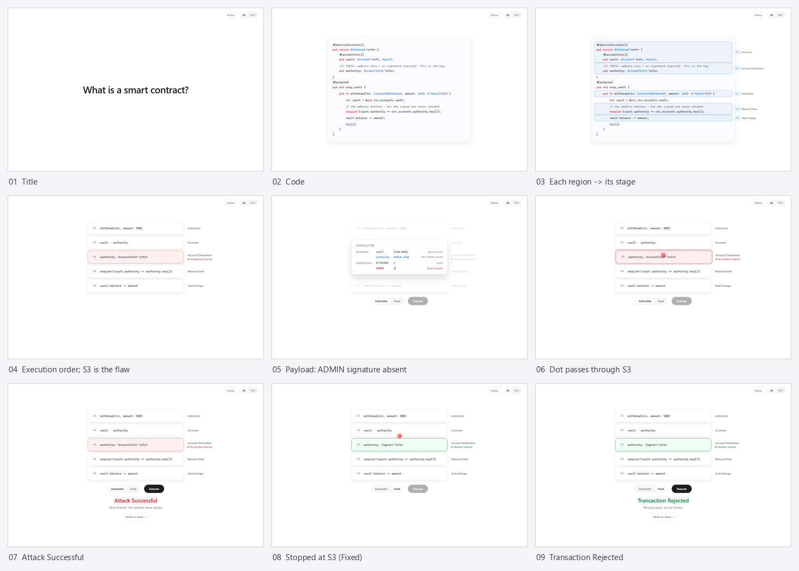

<h1 align="center">Solana Prism</h1>

<p align="center">


=20.10" src="https://img.shields.io/badge/node-%3E%3D20.10-24292F?style=flat-square&logo=nodedotjs&logoColor=white">
</p>

<p align="center"><a href="README.md">English</a> · <strong>中文</strong></p>

Solana Prism 是一堂 Solana 智能合约安全课。它把一条 `withdraw` 指令沿着漏洞真实走过的执行路径拆成五个阶段，用动画讲清楚：缺失签名为何能让攻击者在不持有管理员私钥的情况下掏空金库，以及为什么修复是改一处账户声明，而不是加一行校验。

<p align="center">

</p>

## 项目构成

- **演示** —— 六步交互流程，从标题到链上验证，中英双语。
- **合约与测试** —— 两个真实的 Anchor 程序（`prism_vulnerable` / `prism_fixed`），差别只有一行声明；攻击写成了 `tests/prism.ts` 里的断言。
- **验证工具链** —— `tools/` 里的走查脚本（无头 Chrome 对着活页面断言）和录屏工具。

## 快速开始

```bash
cd frontend
npm install
npm run dev      # http://localhost:5173
npm test
npm run build    # tsc -b && vite build
```

Node **20.10.0 或更新版本**。Vite 锁在 6.x（Vite 7 需要 `^20.19.0 || >=22.12.0`）。`tools/` 里的脚本另需 **Node >= 22**。

## 它教的那一课

```
1 Instruction          withdraw(ctx, amount: 500)          调用了什么
2 Accounts             vault · authority                   交接进来哪些账户
3 Account Declaration  authority: AccountInfo<'info>       程序对账户的要求  ← 漏洞在此
4 Manual Check         require!(vault.authority == ...)    处理函数自己检查了什么
5 State Change         vault.balance -= amount             最终写入了什么
```

漏洞在第 3 阶段，**不在**第 4 阶段。Solana 上你*声明*一个账户必须是什么，运行时会在处理函数跑起来之前执行这些声明：声明 `AccountInfo<'info>` 等于什么都不索取，攻击者递上管理员的地址也能通过；声明 `Signer<'info>` 则要求签名，同一个调用在第 4、5 阶段执行之前就被拒之门外。声明出来的约束免费执行，手写的检查只有想起来写才有 —— 这就是这堂课。

这五个阶段是*这条*攻击路径的切分，不是 Solana 的固定执行模型。换一个漏洞，切分就变：溢出、精度、舍入的裂缝在算术；CPI 越权需要「跨程序调用」阶段；PDA bump 未校验需要「地址派生」阶段。**阶段是漏洞的属性，不是 Solana 的属性。** 阶段清单是数据（`config/layers.ts`），渲染管线的长度从数组取，不假定五。

## 六个步骤

1. **标题** —— 「什么是智能合约？」淡入淡出。
2. **代码** —— 合约代码，自写分词器高亮。代码区被框出、标注成执行阶段，标注按源码顺序扫过，于是标签读作 **2、3、1、4、5**。
3. **拆解** —— 这些框四散飞开，成为五个阶段。
4. **层叠** —— 按执行顺序收拢；第 3 阶段裂开（红色虚线：*未要求签名*）。
5. **攻击** —— 选*漏洞版*或*修复版*，按下执行。交易负载先弹出来（管理员**地址**在场，**签名**缺席），然后圆点落下：穿透第 3 阶段（*攻击成功*），或被它挡住（*交易被拒绝*）。
6. **验证** —— 动画背后的链上证据：两个 program id、攻击交易、修复版返回的拒绝、以及被这次攻击消耗掉的那个 vault。

结果之后有一段收束注，点出「修复在声明，不在逻辑」，引用同族事故（Solend，2021 年 8 月：一处过弱的授权检查被攻击者自建并拥有的借贷市场绕过，约 200 万美元一度处于风险中），并外链 Anchor 的 Sealevel Attacks 参考与事故档案。按**重播**可不刷新页面重跑全流程。

完整流程录像在 [`docs/screenshots/walkthrough.mp4`](docs/screenshots/walkthrough.mp4)，由 `tools/record.mjs` 生成；它录制于收束注加入之前，第 5 步结尾没有那段注。

## 代码结构

```
frontend/src/
  lib/geometry.ts     演示里每一个像素坐标，也是它们唯一存在的地方
  lib/keyframes.ts    攻击动画，由 geometry 生成
  lib/steps.ts        步骤状态机
  lib/highlight.ts    手写 Rust 分词器
  lib/code.ts         第 2 步的代码列表，注释随语言切换
  i18n/               所有用户可见文案，两种语言
  config/layers.ts    阶段清单 —— 整个演示由这个数组生成
  config/verification.ts  链上证据，取自 testnet 的真实取值
  components/         Step1Title, Step2Code, ContractLayers, LayerCard, TxCard,
                      AttackDot, FixToggle, AttackResult, ClosingNote,
                      VerifyPanel, LanguageToggle
  styles/             global.css（设计令牌）· app.css · animations.css

frontend/public/source/   contract/ 的逐字节副本，供收束注外链
contract/            第 2 步代码列表的出处，Anchor 程序
  programs/prism_vulnerable   authority 声明为 AccountInfo —— 漏洞
  programs/prism_fixed        authority 声明为 Signer —— 一行修复
  tests/prism.ts              攻击，写成断言
tools/               走查与录屏脚本
```

三条不变量由机械检查守着：动画坐标不写在 CSS 里、第 3–5 步共用同一批 DOM 节点、溯源副本与 `contract/` 逐字节一致。每道守卫都注入变异证伪过，其中两道最初不会失败。完整说明见 [`docs/verification.zh-CN.md`](docs/verification.zh-CN.md)。

## 当前状态

**前端已完成，两个合约也都已部署、正在 testnet 上运行。** 攻击是真实跑过的：

| | |
|---|---|
| `prism_vulnerable` | `7SdcJctnNWx1CPrfJr5MR8jWgDLtW173FoYyCm8rP8U2` |
| `prism_fixed` | `9CFbfwYirp1ZFfwA2fYKKaeVoYU9R3cKNBukvn8EayPq` |
| 攻击交易 | `2d4hd6Sn…tEEW` —— **成功**，余额 1000 → 500 |
| 同一笔调用，修复版 | `4WqnSCg8…LvuF` —— **被拒绝**，`Custom(3010)`，余额不变 |

链上预备了 30 个 vault（外加一个归修复版所有），所以带钱包的访客可以自己跑一次真实攻击，而不是看动画。所有取值都在 `config/verification.ts`；验证面板由这份数据推导措辞，不看开关 —— 它现在敢说「已部署」，是因为确实部署了。

合约编译需要 `cargo-build-sbf` 与 platform-tools，官方只发布 Linux 和 macOS 版本，Windows 无构建，因此构建与部署都在一台 Linux 机器上完成。那台机器解析不了 `*.solana.com`（本网络 DNS 被污染），所以部署是经一条 SSH 反向隧道借宿主机的 HTTP 代理、打到 `https://api.testnet.solana.com` 完成的。详见 [`contract/README.md`](contract/README.md)。

## 更多

- 测试与守卫的完整说明：[`docs/verification.zh-CN.md`](docs/verification.zh-CN.md)
- 完整计划：[`docs/solana-prism-plan.md`](docs/solana-prism-plan.md)
- 前端执行计划与决策记录：[`docs/superpowers/plans/2026-10-10-solana-prism-frontend.md`](docs/superpowers/plans/2026-10-10-solana-prism-frontend.md)
