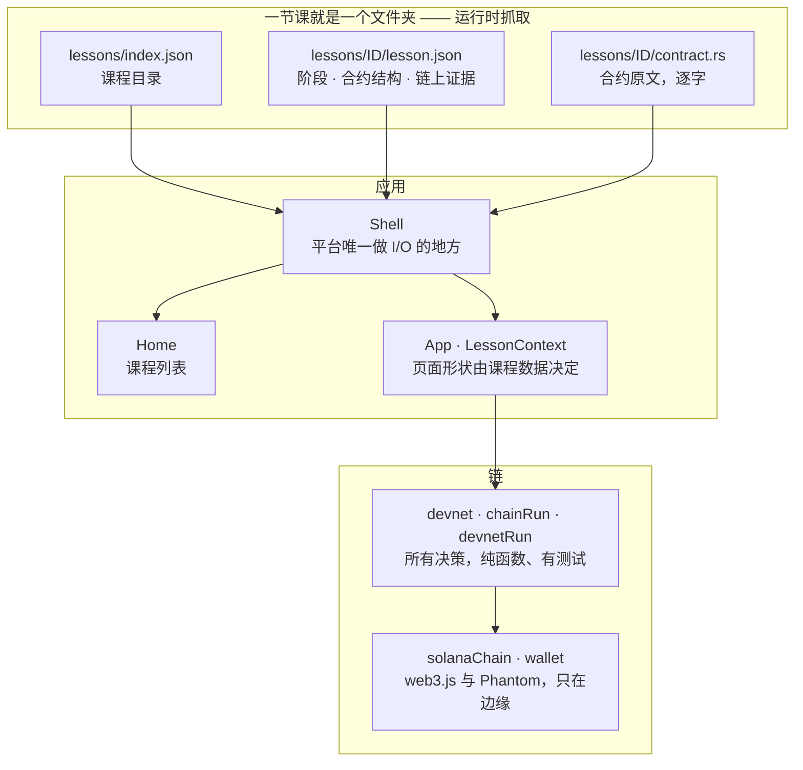

<h1 align="center">Solana Prism</h1>

<p align="center">


=20.10" src="https://img.shields.io/badge/node-%3E%3D20.10-24292F?style=flat-square&logo=nodedotjs&logoColor=white">
</p>

<p align="center"><a href="README.md">English</a> · <strong>中文</strong></p>

Solana Prism 是一个讲 Solana 智能合约安全的课程平台。一节课沿着漏洞真实走过的执行路径把它拆开，然后真的跑一遍：读者看到的攻击是 testnet 上的一笔交易，课程说的每一句话背后都有一个可在浏览器上查到的签名。

整个东西立在两个想法上。

**课是数据。** 一节课就是一个静态文件夹 —— 一条目录项、一份描述阶段与证据的 JSON、一份逐字的合约。应用在运行时抓取这个文件夹并渲染它，Shell 以下没有任何一层 import 课程内容，所以页面、流程图与验证面板完全由文件夹说了算。**不是**数据的，是一节课所用的词汇和它发出的指令：阶段名、页边注 key、漏洞徽章措辞是同一份共享的、带类型的清单，课程需要平台还没有的词时就去扩展它；而每个漏洞都带来自己的指令代码。两者都在[加一节课](#加一节课)里说明。

**链没确认过的，一句都不说。** 攻击下方的结论是集群给的，不是本地规则算的；验证面板由证据数据推导措辞，不看部署开关；撑住这些性质的不变量是机械检查，不是自觉。

## 快速开始

```bash
cd frontend
npm install
npm run dev      # http://localhost:5173 —— 打开是课程列表
npm test         # 单元测试套件（30 个文件）
npm run build    # tsc -b && vite build
```

Node **20.10.0 或更新版本**。Vite 锁在 6.x（Vite 7 需要 `^20.19.0 || >=22.12.0`）。`tools/` 里的脚本另需 **Node >= 22**。

课程文件夹是通过 HTTP 抓取的，所以要么跑开发服务器，要么用构建出来的 `dist/`，不能直接开 `file://`。

## 架构



分层依据是**什么能在没有浏览器的情况下被测试**，从上往下：

| 层 | 职责 | 位置 |
|---|---|---|
| Shell | 平台唯一做 I/O 的地方 —— 抓目录、抓选中的课程、决定「列表还是课内」 | `components/Shell.tsx` |
| 课程格式 | 应用渲染的那个文件夹，以及 JSON 边界：import 时 TypeScript 免费给的那些保证，在这一层于运行时重新建立 | `public/lessons/`, `lib/lesson.ts` |
| 渲染管线 | 页数与阶段数都从课程自己的数组取；课程以 prop 和 context 抵达组件树，从不以 import | `App.tsx`, `lib/lessonContext.ts` |
| 决策层 | 池子扫描、交易构造、某个结果意味着什么 —— 对注入的 I/O 求值的纯函数，所以每个分支都是单元测试 | `lib/devnet.ts`, `lib/chainRun.ts`, `lib/devnetRun.ts` |
| 边缘适配器 | 只有这两个文件知道 web3.js 和 Phantom | `lib/solanaChain.ts`, `lib/wallet.ts` |
| 呈现 | 组件，以及两种语言的全部用户可见文案，收在一份带类型的目录后面 | `components/`, `i18n/` |

### 课程文件夹

```
public/lessons/
  index.json              首页读取的课程目录
  <id>/lesson.json        阶段、合约的结构、链上证据
  <id>/contract.rs        合约原文，逐字
```

`lesson.json` 装着阶段清单、合约的哪些行属于哪个阶段、钉在这些行上的页边注，以及验证面板据以说话的证据。渲染器从那个数组取阶段数，不假定六；每个阶段的散开偏移和代码行也来自数据 —— 这正是这个格式通用的原因，而不是碰巧套得上一节课。

JSON 抹掉了 TypeScript 本来免费给的一条保证：每个 `sayKey`、`nameKey`、注记 key 都指向真实存在的目录条目。`lib/lesson.ts` 在运行时把它重新建立起来 —— 目录里没有的 key，或者越过 `contract.rs` 末尾的区域，都是 shell 老老实实报出来的 `LessonError`，绝不是屏幕上一句空白，更不是白屏。

### 打开一节课发生了什么

1. shell 抓 `lessons/index.json`；`Home` 渲染课程目录，并且在载入中或抓取失败时照实说明。
2. 打开其中一条会去抓那节课的文件夹、校验它，并把拼装好的 `Lesson` 交给 `App`。指向不存在课程的 id 永远不会变成一次抓取。
3. `App` 通过 `LessonContext` 把它提供下去；下面每一页都从它读取阶段、合约行和证据。
4. 链那一层自己从不读课程数据 —— program id、管理员地址、池子大小都以参数传入，所以它能对着一个 fixture 被完整跑一遍。

## 功能

- **课程目录** —— 一个列出平台都装了什么的落地页，以及从每一页都能走出去的返回入口。
- **课即数据** —— 一节课的全部内容就是文件夹里的三个文件；没有任何组件认得某一节课。
- **默认就是真执行** —— 按*执行*就会发出真实的 testnet 交易，不要求访客装任何东西。
- **钱包是可选路径** —— 同一次运行可以用访客自己的密钥做；默认路径不依赖它。
- **不会夸大其词的面板** —— program id、攻击交易、被挪动的余额，全部外链到区块链浏览器，全部由课程数据推导。
- **诚实的失败状态** —— 池子用尽、没有配置 authority、RPC 不应答，三种都各自用控件自己的话说明，绝不把一次没发生的掏空演成动画。
- **两种语言** —— 收在一份带类型的目录后面，某种语言有、另一种没有的 key 是编译错误。

### 真的打到链上

*执行*由随前端一起发布的一对演示密钥签名（`config/demoSigner.ts`）。这是一个刻意的、被接受的取舍：没有它，不装钱包的访客 —— 也就是几乎所有人 —— 只能看动画，而那正是这个演示存在的意义所要反驳的东西。这把密钥只用于 testnet，里面有一点点 testnet SOL 付手续费，而且它**永远不是**金库池的 authority —— 传给 `withdraw` 的 `authority` 账户是管理员的公钥，没有人以管理员身份签名。任何读了打包产物的人都能花掉它的手续费余额，这就是全部的风险敞口，而金库池可以重新灌满。**它绝不能指向主网。**

结论是链给的（`lib/devnetRun.ts`），不是本地规则算的：动画只决定结果*何时*可以显示，从不决定结果*是什么*。

## 加一节课

一节课的**内容**是三个文件加一条目录项：

1. `public/lessons/<id>/contract.rs` —— 合约，与编译出来的一模一样。
2. `public/lessons/<id>/lesson.json` —— 它的阶段、变成这些阶段的行区间、页边注，以及链上证据。
3. 在 `public/lessons/index.json` 里加一条，写明 id，以及标题和一句话简介对应的目录 key。

然后在 `i18n/messages.ts` 里两种语言都补上这些目录 key。只要这堂课说的是平台已有的词汇、发的是链那一层已经会的调用，到此就结束了 —— 不用碰组件，没有注册表，也没有构建步骤。

有两样东西不是内容，需要它们的课得用代码说话：

- **平台还没有的词。** 阶段名（`i18n/messages.ts`）、页边注 key（`lib/contractSource.ts`）、漏洞徽章的措辞（`config/layers.ts` 与文案目录）各是一份共享的、带类型的清单。一节课如果它的漏洞是 owner 未校验而不是缺签名，或者它靠反序列化而不是手写校验读取状态，就往这些清单里加一个 key。每份清单只有一个来源，所以类型和 `lib/lesson.ts` 对抓来的 JSON 跑的检查不会各说各话。
- **平台还没有的指令。** 链那一层是按漏洞写的，不是一个插件接口：一节课带来它自己那几个调用的选择器、账户表和地址派生。这躲不掉 —— 不同漏洞*就是*不同的指令 —— 也正因如此，决策层是对注入的 I/O 求值的纯函数，新一课的指令能和现有的一样被测试。

## 一个实例：没人要求过的那枚签名

平台自带的第一课。一个 `withdraw` 处理函数把调用者与记录在案的管理员作比较，却从没让运行时去校验签名。

```
0 Vault Setup          vault.authority = ctx.accounts.authority.key()   金库被告知该信任谁
1 Instruction          withdraw(ctx, amount: 500)                       调用了什么
2 Accounts             vault · authority                                交接进来哪些账户
3 Account Declaration  authority: AccountInfo<'info>                    程序对账户的要求  ← 漏洞在此
4 Manual Check         require!(vault.authority == ...)                 处理函数自己检查了什么
5 State Change         vault.balance -= amount                          最终写入了什么
```

漏洞在第 3 阶段，**不在**第 4 阶段。Solana 上你*声明*一个账户必须是什么，运行时会在处理函数跑起来之前执行这些声明：声明 `AccountInfo<'info>` 等于什么都不索取，攻击者递上管理员的地址也能通过；声明 `Signer<'info>` 则要求签名，同一个调用在第 4、5 阶段执行之前就被拒之门外。声明出来的约束免费执行，手写的检查只有想起来写才有。

这六个阶段是*这条*攻击路径的切分，不是 Solana 的固定执行模型 —— 溢出裂在算术，CPI 越权需要一个跨程序调用阶段，PDA bump 未校验需要一个地址派生阶段。**阶段是漏洞的属性，不是 Solana 的属性**，所以这份清单是课程数据，不是代码。

这一课以八个页面呈现：标题；部署上去的合约用自写分词器列出，每个区域被框出并标注成它将变成的阶段；这些框飞散开、收拢成执行顺序的流程图；攻击者把管理员的*公开*地址填进调用者那一格；攻击，真实跑一次；这个错误为什么这么容易犯（它抄的那句 Solidity 校验是对的）；一行修复；以及同一个攻击被修复版拒绝。它的三个程序都部署在 testnet 上，攻击也真的跑过 —— 见[当前状态](#当前状态)。

## 验证

`npm test` 覆盖几何、页面状态机、关键帧生成器、Rust 分词器、课程加载器及其失败路径、链上决策，以及文案目录。三条不变量由机械检查守着，不靠人看：

1. **动画坐标不写在 CSS 里** —— 偏移在 `lib/geometry.ts` 算好，攻击关键帧在运行时生成；三条互不等价的检查覆盖它，其中一条会去读样式表**和生成器自己的源码**。
2. **第 3–8 页共用同一批 DOM 节点** —— 卡片是在布局之间*飞行*，不是被重建；这一条没法靠读源码证明，所以是对着活页面实证的。
3. **溯源链条成立** —— `lessons/<id>/contract.rs` 与 `public/source/prism_vulnerable.rs.txt` 逐字节一致，而后者又被钉在 `contract/` 上。

每道守卫都注入变异证伪过，其中两道最初不会失败。完整说明（含无头 Chrome 走查脚本与录屏工具）见 [`docs/verification.md`](docs/verification.md)。

## 当前状态

**前端已完成，这一课的程序也都已部署、正在 testnet 上运行。** 攻击是真实跑过的：

| | |
|---|---|
| `prism_vulnerable` | `7SdcJctnNWx1CPrfJr5MR8jWgDLtW173FoYyCm8rP8U2` |
| `prism_fixed` | `9CFbfwYirp1ZFfwA2fYKKaeVoYU9R3cKNBukvn8EayPq` |
| 攻击交易 | `2d4hd6Sn…tEEW` —— **成功**，余额 1000 → 500 |
| 同一笔调用，修复版 | `4WqnSCg8…LvuF` —— **被拒绝**，`Custom(3010)`，余额不变 |

链上预备了 `PLATFORM.poolSize` 个 vault（200 个），外加一个归修复版所有，所以访客可以自己跑一次真实攻击，而不是看动画。

合约编译需要 `cargo-build-sbf` 与 platform-tools，官方只发布 Linux 和 macOS 版本，Windows 无构建，因此构建与部署都在一台 Linux 机器上完成。那台机器解析不了 `*.solana.com`（本网络 DNS 被污染），所以部署是经一条 SSH 反向隧道借宿主机的 HTTP 代理、打到 `https://api.testnet.solana.com` 完成的。

## 更多

- 测试与守卫的完整说明：[`docs/verification.md`](docs/verification.md)
- 完整计划：[`docs/solana-prism-plan.md`](docs/solana-prism-plan.md)
- 前端执行计划与决策记录：[`docs/superpowers/plans/2026-10-10-solana-prism-frontend.md`](docs/superpowers/plans/2026-10-10-solana-prism-frontend.md)
- 八页流程图与实现计划：[`docs/superpowers/plans/2026-10-11-flow-redesign.md`](docs/superpowers/plans/2026-10-11-flow-redesign.md)
