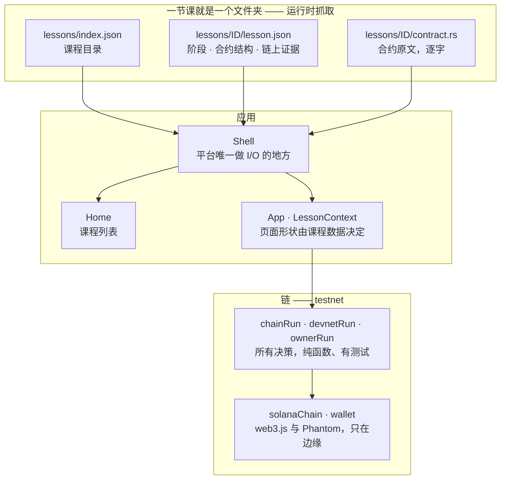

<h1 align="center">Solana Prism</h1>

<p align="center"><strong>每节课讲一个 Solana 漏洞 —— 沿着漏洞真实走过的执行路径把它拆开，然后在 testnet 上真的跑一遍。</strong></p>

<p align="center">


</p>

<p align="center"><a href="README.md">English</a> · <strong>中文</strong></p>

## 这是什么

Solana Prism 是一个讲 Solana 智能合约安全的课程平台。一节课挑一个漏洞，沿着漏洞真实走过的执行路径把合约拆开 —— 这次调用经过的每一个阶段，以及错误藏身的那一行。然后它真的跑一遍：读者看到的攻击是 testnet 上的一笔交易，课程说的每一句话背后都有一个能在浏览器上查到的签名。链没确认过的，一句都不说 —— 所以攻击下方的结论是集群给的，不是本地规则算的；验证面板说的是课程证据本身，而不是某个部署开关。

## 快速开始

```bash
cd frontend
npm install
npm run dev      # http://localhost:5173 —— 打开是课程列表
npm test         # 单元测试套件（33 个文件，359 个测试）
npm run build    # tsc -b && vite build
```

跑应用需要 **Node 20.10.0 或更新版本**。Vite 锁在 6.x（Vite 7 需要 `^20.19.0 || >=22.12.0`）。`tools/` 里的脚本另需 **Node >= 22**。

课程文件夹是通过 HTTP 抓取的，所以要么跑开发服务器，要么用构建出来的 `dist/` —— 直接用 `file://` 打开是行不通的。

## 工作原理



分层依据是**什么能在没有浏览器的情况下被测试**，从上往下：

| 层 | 职责 | 位置 |
|---|---|---|
| Shell | 平台唯一做 I/O 的地方 —— 抓目录、抓选中的课程、决定「列表还是课内」 | `components/Shell.tsx` |
| 课程格式 | 应用渲染的那个文件夹，以及 JSON 边界：import 时 TypeScript 免费给的那些保证，在这一层于运行时重新建立 | `public/lessons/`, `lib/lesson.ts` |
| 渲染管线 | 页数与阶段数都从课程自己的数组取；课程以 prop 和 context 抵达组件树，从不以 import | `App.tsx`, `lib/lessonContext.ts` |
| 决策层 | 池子扫描、交易构造、某个结果意味着什么 —— 对注入的 I/O 求值的纯函数，所以每个分支都是单元测试 | `lib/chainRun.ts`, `lib/devnetRun.ts`, `lib/ownerRun.ts` |
| 边缘适配器 | 只有这两个文件知道 web3.js 和 Phantom | `lib/solanaChain.ts`, `lib/wallet.ts` |
| 呈现 | 组件，以及两种语言的全部用户可见文案，收在一份带类型的目录后面 | `components/`, `i18n/` |

### 课程文件夹

**课是数据。** 一节课就是一个静态文件夹，应用在运行时抓取并渲染它；Shell 以下没有任何一层 import 课程内容，所以页面、流程图与验证面板完全由文件夹说了算。

```
public/lessons/
  index.json              首页读取的课程目录
  <id>/lesson.json        阶段、合约的结构、链上证据
  <id>/contract.rs        合约原文，逐字
```

`lesson.json` 装着阶段清单、合约的哪些行属于哪个阶段、钉在这些行上的页边注，以及验证面板据以说话的证据。渲染器从那个数组取阶段数，不假定六；每个阶段的散开偏移和代码行也来自数据 —— 这正是这个格式通用的原因，而不是碰巧套得上一节课。

JSON 抹掉了 TypeScript 本来免费给的一条保证：每个 `sayKey`、`nameKey`、注记 key 都指向真实存在的目录条目。`lib/lesson.ts` 在运行时把它重新建立起来 —— 目录里没有的 key，或者越过 `contract.rs` 末尾的区域，都是 shell 老老实实报出来的 `LessonError`，绝不是屏幕上一句空白，更不是白屏。

## 真的打到链上

*执行*由随前端一起发布的一对演示密钥签名（`config/demoSigner.ts`）。这是一个刻意的、被接受的取舍：没有它，不装钱包的访客 —— 也就是几乎所有人 —— 只能看动画，而那正是这个演示存在的意义所要反驳的东西。这把密钥只用于 testnet，里面有一点点 testnet SOL 付手续费，而且它**永远不是**金库池的 authority —— 传给 `withdraw` 的 `authority` 账户是管理员的公钥，没有人以管理员身份签名。任何读了打包产物的人都能花掉它的手续费余额，这就是全部的风险敞口，而金库池可以重新灌满。**它绝不能指向主网。**

结论是链给的（`lib/devnetRun.ts`），不是本地规则算的：动画只决定结果*何时*可以显示，从不决定结果*是什么*。

## 加一节课

一节课的**内容**是三个文件加一条目录项：

1. `public/lessons/<id>/contract.rs` —— 合约，与编译出来的一模一样。
2. `public/lessons/<id>/lesson.json` —— 它的阶段、变成这些阶段的行区间、页边注，以及链上证据。
3. 在 `public/lessons/index.json` 里加一条，写明 id，以及标题和一句话简介对应的目录 key。

然后在 `i18n/messages.ts` 里两种语言都补上这些目录 key。只要这堂课说的是平台已有的词汇、发的是链那一层已经会的调用，到此就结束了 —— 不用碰组件，没有注册表，也没有构建步骤。

有两样东西不是内容，需要它们的课得用代码说话：

- **平台还没有的词。** 阶段名（`i18n/messages.ts`）、页边注 key（`lib/contractSource.ts`）、漏洞徽章的措辞（`config/layers.ts` 与文案目录）各是一份共享的、带类型的清单。一节课如果它的漏洞是 owner 未校验而不是缺签名，或者它靠反序列化而不是手写校验读取状态，就往这些清单里加一个 key。每份清单只有一个来源，所以类型和 `lib/lesson.ts` 对抓来的 JSON 跑的检查不会各说各话。
- **平台还没有的指令。** 链那一层是按漏洞写的，不是一个插件接口：一节课带来它自己那几个调用的选择器、账户表和地址派生。这躲不掉 —— 不同漏洞*就是*不同的指令 —— 也正因如此，决策层是对注入的 I/O 求值的纯函数，新一课的指令能和现有的一样被测试。

所以，课里出现的文案，仍然是 `i18n/messages.ts` 里带类型的内容；让一个新漏洞能跑起来的接线，也仍然是代码。文件夹给的是：这两样都不再按课重复 —— 新课只是往共享的清单里加 key 和指令，而不是新开一整页。

## 测试

```bash
cd frontend && npx vitest run --reporter=dot
```

```
Test Files  33 passed (33)
     Tests  359 passed (359)
```

`docs/verification.md` 是这一节的长版本：套件守着哪些不变量、每个检查在什么层面抓违规，以及每个护栏是怎么被证伪的。

## 现状

- **已部署到 testnet** —— 两节课，五个程序（每节课各有漏洞版与修复版，外加第二课需要的攻击者伪造程序）。两个攻击都对着线上程序真跑过。✅
- **单元测试全绿** —— 33 个文件，359 个测试。✅
- **尚未托管** —— 没有公开网址。本地用 `npm run dev` 跑。
- **录制的演示早于第二课** —— `docs/screenshots/` 里只有第一课。
- **CI 跑前端** —— `.github/workflows/ci.yml` 在每次 push 和 pull request 上跑
  `npm ci`、`npm test` 和 `npm run build`。它不构建合约：那需要 `cargo-build-sbf`
  和 platform-tools，标准 runner 上没有（见 `contract/README.md`）。

## 许可证

本项目采用 [MIT 许可证](LICENSE)。
